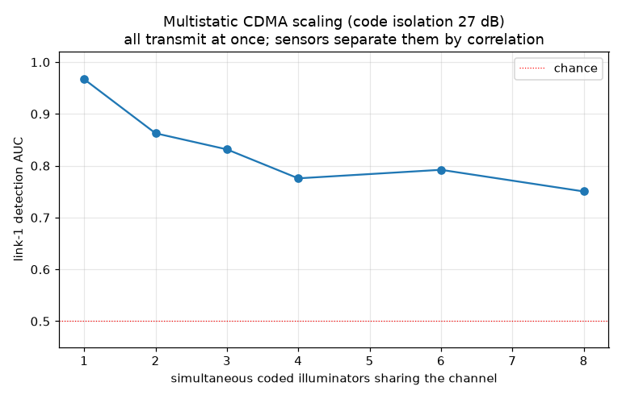

# RadioVision

**Active Wi-Fi channel sounding for motion sensing on the ESP32-S3.** Two or more
boards, no extra RF hardware: illuminators transmit a known, keyed, spread-spectrum
waveform; sensors capture raw IQ, reconstruct the full channel impulse response,
and detect people moving through the link. It uses the ESP32's own 2.4 GHz radio as
a software-defined transceiver via the raw-IQ path, and **scales to a mesh** —
every illuminator uses its own code, so sensors separate them by correlation (one
link per illuminator) and you add coverage just by adding boards.

## How it works

```
 TX board (illuminator) ......)))   person   (((...... RX board (sensor)
   loops a keyed ZC / Gold code         |            captures raw-IQ bursts
   out of the radio DAC                 |            -> channel impulse response
                                    (moves here)     -> motion
```

- **TX board** continuously replays a keyed Zadoff-Chu / Gold / m-sequence code
  out of the radio's DAC (constant envelope, ideal autocorrelation).
- **RX board** captures raw-IQ bursts, correlates against the known code to
  recover the **complex channel impulse response (CIR)**, estimates and removes
  the carrier-frequency offset between the two crystals, and detects motion as a
  change in a **gain- and timing-invariant** feature of the channel.
- The same waveform can carry an **encrypted DSSS data payload**, so one
  transmission both probes the channel and links the two devices.

All signal processing is one portable C core (`rv_dsp`) that runs **identically**
on the host (for validation) and on the ESP32-S3.

## Why active sounding beats standard CSI sensing

Standard Wi-Fi CSI sensing is **passive**: it waits for ordinary Wi-Fi packets and
reads the channel estimate the receiver derives from the short training fields.
You get ~52-64 subcarriers, sampled whenever a packet happens to arrive, scaled by
an automatic gain control you don't control, with no processing gain. RadioVision
**chooses the excitation and owns both ends**:

| | standard CSI sensing | RadioVision (active sounding) |
|---|---|---|
| excitation | whatever ambient packets exist | a waveform you design and key |
| channel estimate | ~52-64 subcarriers from brief training fields | full complex CIR, full band |
| SNR | fixed by the arriving packet | **+ 10·log10(N·R) ≈ 41 dB** processing gain |
| gain (AGC) | scales the estimate -> corrupts detection | gain-invariant feature |
| timing / clock | not handled | CFO removed; timing-invariant feature |
| spectrum use | needs busy channel / injected packets | **~30 dB lower PSD**, noise-like |
| security | none | the code is the key; payload is DSSS |

The charts below quantify each row.

## Results

Every number comes from running the **actual firmware DSP** (`rv_dsp.c`) over a
2.4 GHz physics channel simulator; the same C core is proven numerically identical
on the ESP32-S3 in QEMU. Reproduce: `validate/build_and_validate.sh`. Methodology:
[docs/VALIDATION.md](docs/VALIDATION.md).

### Detection accuracy vs standard CSI — the headline


Single-burst ROC for a weak moving reflection (−20 dB relative to the direct
path), same physical scene for every curve. The **standard CSI amplitude-variance
detector falls to AUC 0.53 — a coin flip — under just 3 dB of AGC gain stepping**,
which is exactly what happens when a person changes the received power and the
radio re-ranges its gain. RadioVision's gain-invariant feature is unaffected
(**0.79**), shrugs off a 2 kHz carrier-frequency offset (0.74), and with a shared
TX/RX clock reaches **0.998**. The difference is the method, not the scenario.

### Processing gain — hear the channel below the noise floor


Correlating against a known, full-band code pulls the channel out of noise with
**40.8 dB of processing gain** (theory 40.9 dB), and the sounder still acquires
when the signal is **~31 dB below the noise** per sample. Standard CSI has no
equivalent — its SNR is whatever the arriving packet delivers. This headroom is
what lets the transmitter run at very low power (next chart).

### Interference footprint — quiet by design


For the *same* detection SNR, the keyed spread-spectrum waveform spreads its energy
across 40 MHz at low power, so its average power spectral density sits **~30 dB
below** a CSI-style ping flood — down near the ambient noise floor and
statistically noise-like to anything without the key. Standard CSI instead needs
the channel to be busy, or you inject traffic to make it busy.

### Channel reconstruction quality


Owning the waveform means we recover the **full complex channel impulse response**,
and its accuracy improves about 1 dB per dB of SNR (−12 dB NMSE at 0 dB input).
Standard CSI only ever sees a sparse, noisy frequency-response snapshot from brief
training fields of whatever packet arrived.

### Sensitivity


How faint a moving reflection a *single* burst can catch under realistic
free-running-crystal timing jitter: AUC 0.95 at −10 dB, 0.83 at −16 dB, tapering to
chance for very weak targets. The detector's multi-burst hysteresis (it requires
several consecutive crossings) pushes the usable operating point well beyond these
single-burst numbers, and a shared clock lifts the whole curve toward the coherent
limit.

### Scaling to more devices



The keyed waveform is also how the system scales. Each illuminator gets a distinct
code (auto-derived from its MAC), they all transmit **at once on the same channel**,
and each sensor separates them by correlation — one independent link per
illuminator, from a single capture. Measured code isolation is **27.1 dB** (exactly
`10·log10(N)`), so links interfere only at a `~1/N` floor: detection degrades
gracefully from AUC 0.97 (1 illuminator) to 0.75 (8 sharing the channel). Add a
board and it's a new code = a new link, with no coordination and no time slotting —
and more links mean wider coverage and the basis for localizing *which* link a
target crossed.

## Repository layout

```
firmware/
  components/rv_dsp/     portable C DSP core (waveform, CIR, CFO, |H| feature, detector)
                        -> the SAME source runs on the host and the ESP32-S3
  components/rv_radio/   ESP32-S3 raw-IQ capture + TX replay via the radio's own
                        baseband path (docs/UNDOCUMENTED_PHY.md)
  rv_sounder/            the sounder app (menuconfig: role + illumination source);
                        main/rv_wifi.c is the certified-path illumination + CSI mode
  rv_selftest/           boots + runs the DSP self test (host/device identity proof)
validate/                physics simulator + ctypes harness that calls the real C core
docs/                    DESIGN, VALIDATION, UNDOCUMENTED_PHY, COMPLIANCE, figures/
rv demo/                 earlier passive-CSI experiment (kept for reference)
```

## Build and run

Validation (host):
```bash
validate/build_and_validate.sh
```

Firmware (ESP-IDF v5.5.x, esp32s3):
```bash
cd firmware/rv_sounder
idf.py set-target esp32s3
idf.py menuconfig        # RadioVision sounder -> role (TX on one board, RX on the other), key, channel
idf.py build flash monitor
```

Two ways to drive the radio, both using the same `rv_dsp`:
- **Direct (default):** flash `rv_sounder` as TX on one board and RX on the other,
  self-contained on the ESP32-S3's own radio.
- **Bridged:** run stock ESP-SDR on the radios and drive them over UART from a
  controller ESP (documented serial protocol); see [docs/DESIGN.md](docs/DESIGN.md).

### Illumination source (menuconfig → RadioVision sounder)

- **`RAW_DAC`** (default): raw-IQ keyed spread-spectrum sounding — the high-performance
  path with processing gain, low-PSD, and CDMA scaling.
- **`WIFI_CERTIFIED`**: the FCC-in-grant path — the illuminator sends HT20 probe
  frames through the **certified** Wi-Fi radio, and the sensor measures them via
  Wi-Fi CSI using the same gain-invariant detector. No undocumented registers run.
  This trades the processing-gain / low-interference advantages for standard-CSI-class
  behavior that stays inside the module's FCC authorization.

## Regulatory compliance

The **sensing/receive side is passive and harmless.** The **raw-IQ transmitter is
not FCC-compliant for open-air use as-is** — not because spread spectrum at 2.4 GHz
is disallowed (§15.247 expressly allows it), but because it transmits through the
undocumented DAC path, which operates the module outside its FCC grant and emits
uncalibrated spurs. Pick the mode for how you'll operate:

- **No licence →** `WIFI_CERTIFIED`: license-exempt Part 15 operation through the
  certified radio.
- **Licensed (amateur) →** `RAW_DAC`, operated per Part 97 (channel 1/6, station
  ID, no message encryption). Raw transmit is gated behind a `RV_TX_ACK` build
  option so the board won't radiate until you confirm a licence or a dummy load.
- **Neither →** `RAW_DAC` on a **dummy load / shielded bench** only.

Two different keyed things, only one restricted: the **spreading code** (the
sounding waveform) is spread spectrum carrying no message — allowed everywhere, and
it's what gives the processing-gain / low-noise-floor and the noise-like,
code-gated obscurity. **Message-payload encryption** is the thing §97.113 forbids on
amateur bands, so it's offered **only in `WIFI_CERTIFIED` (Part 15)** and is
unavailable in `RAW_DAC`. There's no authentication layer — the sounder sends
nothing that needs protecting. Full analysis, limits, and the ham checklist:
[docs/COMPLIANCE.md](docs/COMPLIANCE.md).

> Not legal advice — verify against current 47 CFR Part 15 / Part 97.

## Related work

The move from passive CSI to intentional sounding is the same direction as
IEEE 802.11bf-2025 (WLAN Sensing) and ESPARGOS's raw-IQ "IQ Radar". RadioVision's
angle is doing it on two commodity ESP32-S3 boards with a keyed spread-spectrum
waveform and an on-device detector. The raw-IQ path builds on the ESP-SDR work by
ESPARGOS, cyber-murmel, and h0m3us3r; the `rv demo/` reference is from Cole Studer.
