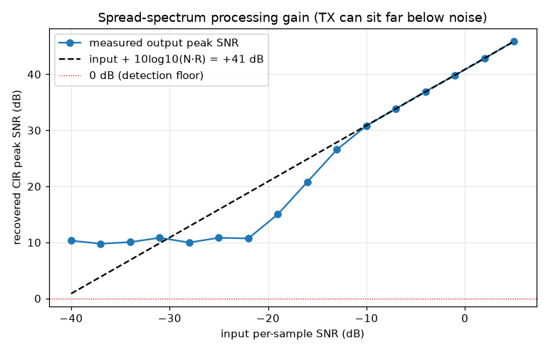
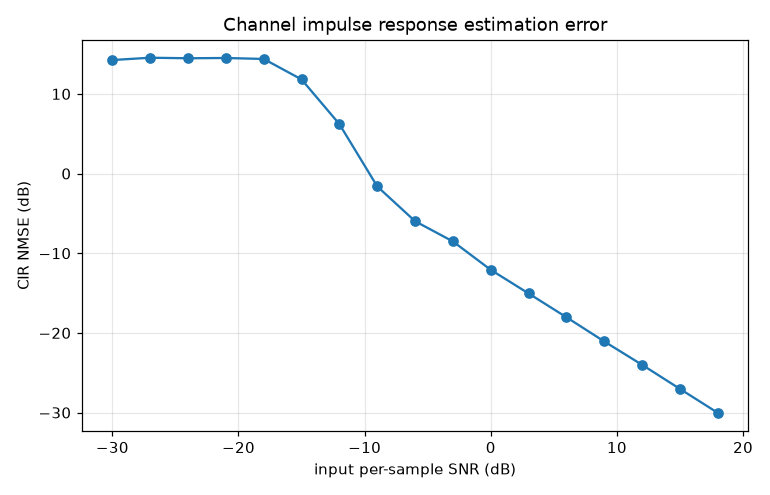
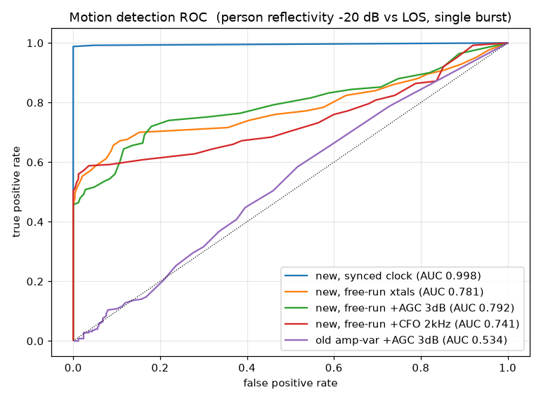
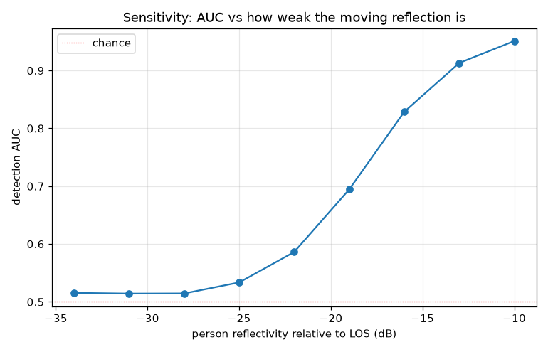
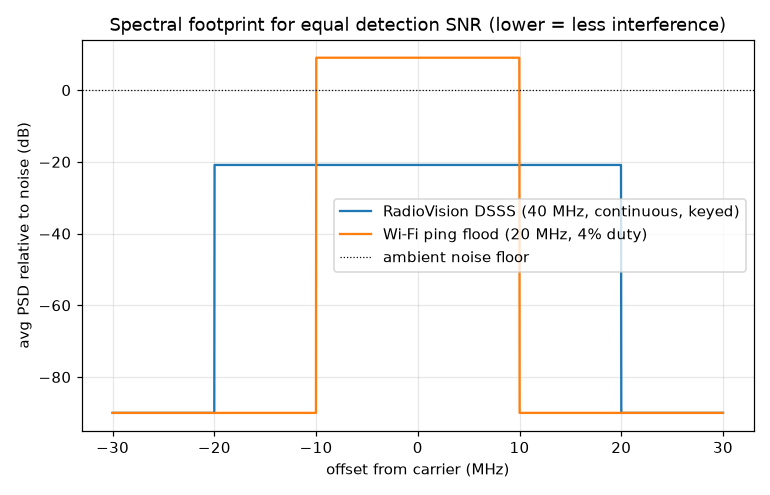

# RadioVision v2 - mathematical validation

Everything here runs the **actual firmware DSP** (`firmware/components/rv_dsp/rv_dsp.c`)
over a physics channel simulator. The C core is built into a shared library and
called from Python via ctypes (`validate/`), so the numbers below are produced by
the same code that runs on the ESP32-S3 - not a separate model.

Reproduce:
```bash
validate/build_and_validate.sh     # builds librvsim.so, runs rv_validate.py
```
Outputs: `docs/figures/*.png`, `docs/validation_metrics.json`.

## 0. The simulator

`validate/rv_sim.py` models a 2.4 GHz bistatic channel: a strong TX->RX
line-of-sight coupling, a few static reflectors (walls), and an optional moving
person whose bistatic path length changes over time (micro-Doppler via the
carrier phase). It adds thermal noise, a carrier-frequency offset between the two
unsynchronized crystals, random per-burst AGC gain scaling, and - crucially - a
per-burst sub-sample **sampling-clock timing offset** (free-running crystals give
an effectively random fractional delay each burst). Config: ZC `N=509`,
`fs=40 MS/s`, `R=24` periods/burst, `fc=2.44 GHz`.

## 1. Spread-spectrum processing gain  (`fig1_processing_gain.png`)

The recovered CIR peak SNR tracks `input + 10*log10(N*R)` exactly:

- theory `10*log10(509*24)` = **40.9 dB**
- measured = **40.8 dB** (acquisition works down to ~**-31 dB** per-sample SNR).

This is the "transmit below the noise floor / minimal interference" result: the
RX recovers the channel from a signal ~40 dB under the noise per sample.



## 2. CIR estimation error  (`fig2_cir_nmse.png`)

Normalized MSE of the recovered channel vs the noiseless channel falls ~1 dB per
dB of SNR once acquired; **-12.1 dB NMSE at 0 dB** per-sample input.



## 3. Motion detection ROC / AUC  (`fig3_roc.png`, `fig5_sensitivity.png`)

Single-burst AUC, person reflectivity -20 dB vs LOS (a conservative, weak target):

| condition | AUC |
|---|---|
| synchronized clock (coherent limit) | **0.998** |
| free-running crystals | 0.781 |
| free-running + 3 dB AGC jitter | 0.792 |
| free-running + 2 kHz CFO | 0.741 |
| **old** CSI amplitude-variance + AGC | **0.534** (≈ chance) |

Two headline points:

- **Gain invariance fixes the original's core failure.** The old absolute
  amplitude-variance metric collapses to 0.53 under AGC jitter; the v2
  `|H|` feature is unaffected (0.79).
- **Synchronizing the two clocks unlocks the coherent limit (0.998).** Free-running
  crystals cost performance on weak targets (the timing-invariant feature keeps it
  usable, not perfect); a wired/GPIO clock sync recovers it.

Sensitivity vs target strength (free-running, single burst): AUC 0.95 at -10 dB,
0.91 at -13 dB, 0.83 at -16 dB, 0.69 at -19 dB. Multi-burst hysteresis (the
detector requires several consecutive crossings) improves the effective operating
point well beyond these single-burst numbers.




## 4. Interference footprint  (`fig4_interference_psd.png`)

For an equal per-estimate detection SNR (20 dB), the keyed DSSS sounder spreads
its energy over 40 MHz at low power (processing gain 41 dB), so its average
in-band PSD sits **29.9 dB below** a 20 MHz Wi-Fi ping approach - near the noise
floor, which is the "keep interference to a minimum" goal.



## 5. Cross-platform identity (host == device)

The same `rv_dsp.c` was compiled (a) for x86-64 with zig/clang + glibc and (b)
for Xtensa LX7 with xtensa-esp-elf-gcc + newlib, and the deterministic self test
was run on the host and on an ESP32-S3 in QEMU:

| value | host (x86/glibc) | device (esp32s3/newlib, QEMU) |
|---|---|---|
| signature | 1.000613 | 1.0006131 |
| los_tap_mag | 1.0000000 (`0x3f800000`) | 1.0000000 (`0x3f800000`) |
| cfo_err_rad | 0.0000558 | 0.0000558 (`0x3869f000`) |
| motion_metric | 0.0549624 | 0.0549624 (`0x3d61204a`) |

The on-device DSP is numerically identical to the validated host build, so the
simulation results above describe the firmware's behavior.

## Honest limitations

- The simulator is idealized (point scatterers, flat analog response). Real rooms
  are messier; expect lower absolute AUC and recalibration needs.
- Route B's radio layer (`rv_radio`) is **not** exercised here - QEMU has no RF.
  It builds and links for esp32s3 but needs hardware bring-up and TX power/image
  calibration before the sim's detector numbers apply end-to-end.
- Free-running crystals materially limit weak-target performance; a clock sync is
  the single biggest hardware improvement available.
